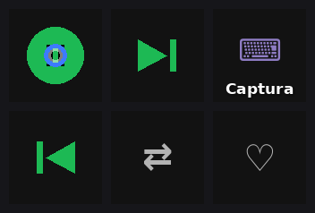
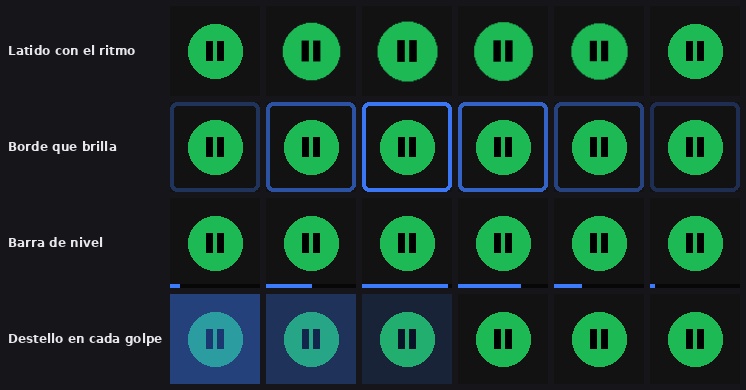
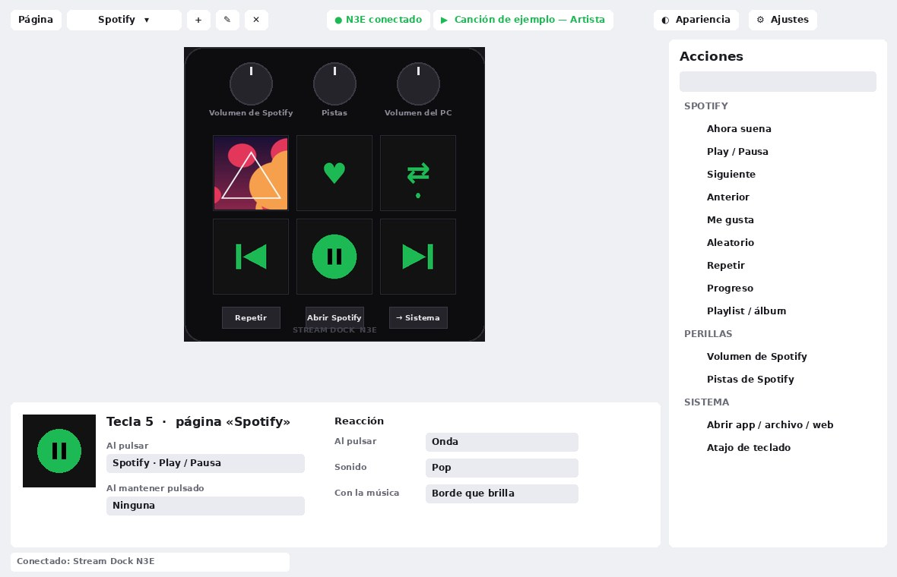
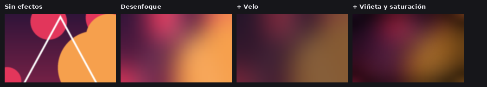
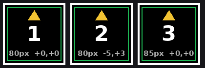
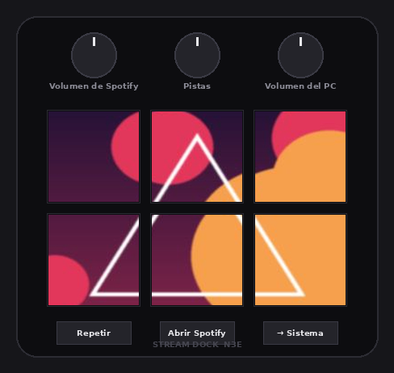
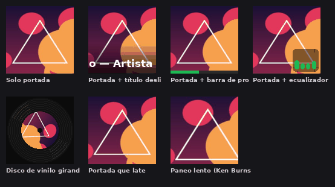
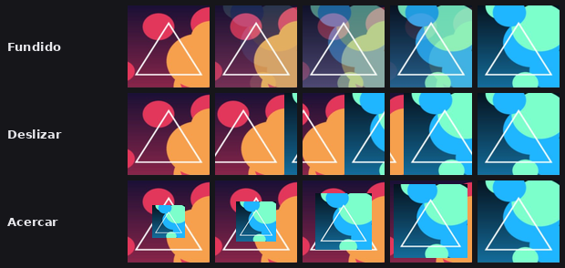
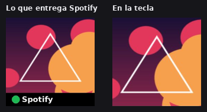
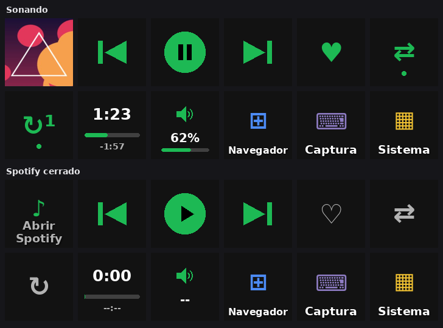

# Historial de versiones

Todos los cambios de Stream Dock Lite, de la más reciente a la más antigua.

---

## 2.7.0 — Rendimiento y efectos de reacción

**Optimización (mismo aspecto, más rápida)**
- Se comprobó con 356 imágenes de referencia (teclas, estilos, fondos, patrones) que todo se dibuja
  **idéntico, píxel por píxel**, al de la 2.5.0.
- Las teclas animadas se dibujan entre 2 y 50 veces más rápido: la portada ya escalada, el degradado
  del título y el disco de vinilo se guardan en caché.
- La ventana reutiliza sus imágenes en vez de crear una nueva por cuadro (teclas, inspector y fondo).
- Con la app oculta junto al reloj, deja de dibujar la vista previa; el N3E sigue animándose igual.
- El volumen de Spotify ya no recorre todos los procesos del PC cada 1,5 s: recuerda la sesión.

**Efectos de reacción** (sección *Reacción* del inspector)
- Al pulsar: onda, destello, hundir, borde de color o chispas, en el N3E y en la vista previa.
- Sonidos al pulsar teclas y botones: clic, pop, tic, suave, teclado mecánico, burbuja y `.wav` propios.
- Teclas que reaccionan al sonido real de Spotify: latido, borde que brilla, barra de nivel y destello
  en cada golpe.
- «Aplicar a todas» copia la reacción a todas las teclas y botones.
- La tecla «Ahora suena» queda sin efectos de reacción.

---

## 2.6.0 — Retirada

- Añadía como fondo el video «Canvas» de Spotify, capturándolo de la ventana de Spotify.
- **Se retiró**: en la práctica no detectaba el video (la captura de ventanas no ve los videos
  acelerados por la tarjeta gráfica) y gastaba demasiado procesador. Se volvió a la 2.5.0, y la 2.7.0
  parte de ella.

---

## 2.5.0 — Apariencia

- Nuevo botón **🎨 Apariencia**.
- Tema **oscuro, claro o como Windows**, con barra de título a juego.
- **Color de acento**: azul, verde Spotify, morado, rosa, naranja, rojo o cian.
- **Fondos** de la ventana: portada de la canción (con fundido al cambiar), imagen, o video/GIF en bucle.
- **Efectos** del fondo: desenfoque, velo, saturación, viñeta y movimiento lento.
- El fondo se pausa con la ventana oculta.
- El título de la ventana muestra la versión real.

---

## 2.4.3 — Centrado fino

- En *Ajustes → Pantallas de las teclas*: flechas **◀ ▲ ▼ ▶** para mover la imagen píxel a píxel y
  **− / +** para ajustar el tamaño de 1 en 1, con vista al momento en el N3E.

## 2.4.2 — Ventanas únicas

- Ajustes, Iconos, Estilos y Registro se abren una sola vez: si ya están abiertos, se traen al frente.

## 2.4.1 — Pantallas de las teclas

- Borra el fondo que deja guardado el software oficial al conectar.
- Tamaño y giro de la imagen ajustables, con un **patrón de prueba** en cada tecla.
- Envío de imágenes protegido para que no se mezcle con otros comandos.

## 2.4.0 — Bandeja, playlists, protector e instalador

- **Icono junto al reloj**: la app sigue funcionando al cerrar la ventana (play/pausa y pistas desde el menú).
- **Teclas de playlists, álbumes, artistas o canciones**: muestran su portada y las reproducen.
- **Protector de pantalla del N3E**: portada gigante en las 6 teclas, bajar brillo o apagar.
- **Instalador `.exe` sin Python**: trae un Python portátil, no pide administrador, crea accesos
  directos y aparece en *Aplicaciones instaladas*.
- Limpieza de archivos que ya no se usaban.

## 2.3.0 — Estilos de «Ahora suena»

- Siete estilos (solo portada, título deslizante, progreso, ecualizador, vinilo, latido, paneo).
- Aspecto en pausa y transiciones al cambiar de canción (fundido, deslizar, acercar).
- Galería con vista previa animada.
- Detección robusta de la franja del logo de Spotify, incluso con portadas oscuras, más recorte manual.

## 2.2.3 — Sin franja de Spotify

- Se quita la franja negra con el logo que Spotify añade bajo la portada.

## 2.2.2 — Solo la portada

- La tecla «Ahora suena» muestra solo la portada: sin nombre de canción ni icono de pausa.

## 2.2.1 — Portada a tecla completa

- La portada llena la tecla completa, sin marco oscuro.

## 2.2.0 — Instalador y actualizaciones

- Instalador sin permisos de administrador, con desinstalador.
- Actualizaciones desde archivo, con copia de seguridad y **vuelta a la versión anterior**.
- Conexión opcional para recibir actualizaciones en una carpeta local, siempre con confirmación.

## 2.1.0 — Biblioteca de iconos

- Galería de iconos con buscador.
- Importa imágenes sueltas, carpetas, `.zip` y `.rar`.

## 2.0.0 — Estilo Elgato y Spotify

- Solo para el Stream Dock N3E (`N3E_1B05`).
- Interfaz oscura estilo Elgato Stream Deck: biblioteca de acciones con arrastrar y soltar, inspector,
  páginas, copiar/pegar e intercambiar teclas.
- Spotify sin iniciar sesión: portada en vivo, play/pausa, pistas, aleatorio, repetir y progreso.
- Volumen **solo de Spotify** en las perillas; «Me gusta» opcional con la API de Spotify.

## 1.0.0 — Primera versión

- Comunicación USB-HID con el N3E: imágenes en las teclas, brillo, botones y perillas.
- Acciones: abrir programas o webs, atajos, texto, multimedia, comandos y páginas.
- Reconexión automática, perfiles exportables y herramienta de diagnóstico.
