# Stream Dock Lite

**Controlador alternativo, ligero y sin cuenta para el Stream Dock N3E (`N3E_1B05`)**, con estilo
Elgato Stream Deck e integración completa con Spotify. Para Windows 10/11.

<p align="center">
  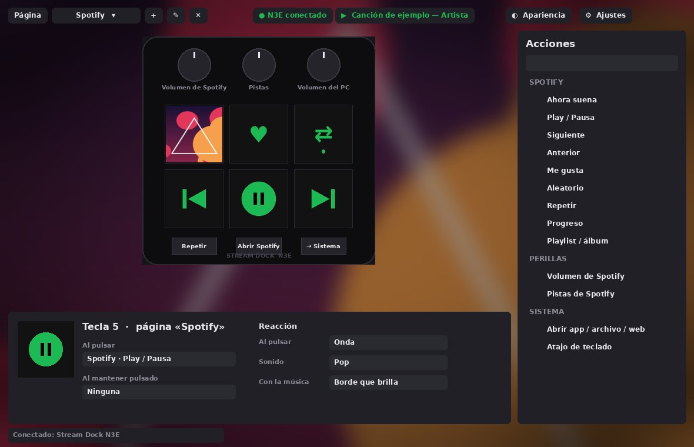
</p>

<p align="center">
  <a href="../../raw/main/descargas/StreamDockLite-Setup.exe"><b>⬇️ Descargar StreamDockLite-Setup.exe</b></a> (recomendado, solo para el N3E_1B05) ·
  <a href="docs/INSTALACION.md">Guía de instalación</a> ·
  <a href="CHANGELOG.md">Novedades</a>
</p>

> ⚠️ **Solo para el Stream Dock N3E (`N3E_1B05`).** No funciona con otros modelos de Stream Dock,
> Mirabox, Ajazz ni con el Elgato Stream Deck. [¿Cómo sé si el mío es compatible?](#dispositivo-compatible)

> 🚧 **Proyecto en desarrollo: no está completo.** Funciona, pero hay partes sin probar en todos los
> equipos y muchas ideas pendientes. **Cualquiera puede hacer sus propios cambios o mejoras**: el código
> es libre (MIT). Mira [cómo hacer cambios o mejoras](CONTRIBUIR.md).

> Proyecto no oficial. No está afiliado a Mirabox, Elgato ni Spotify.
> Las imágenes de esta página usan portadas de ejemplo generadas por el propio proyecto.

## Contenido

- [Dispositivo compatible](#dispositivo-compatible)
- [Qué hace](#qué-hace)
- [Instalación](#instalación) · [guía completa](docs/INSTALACION.md)
- [Spotify](#spotify)
- [Estilos de la tecla «Ahora suena»](#estilos-de-la-tecla-ahora-suena)
- [Reacción de teclas y botones](#reacción-de-teclas-y-botones)
- [Apariencia: temas y fondos](#apariencia-temas-y-fondos)
- [Protector de pantalla](#protector-de-pantalla)
- [Calibrar las pantallas](#calibrar-las-pantallas)
- [Actualizaciones](#actualizaciones)
- [Historial de versiones](#historial-de-versiones)
- [Estado del proyecto y cómo mejorarlo](#estado-del-proyecto-y-cómo-mejorarlo)
- [Para desarrolladores](#para-desarrolladores)
- [Créditos](#créditos)

## Dispositivo compatible

Stream Dock Lite está hecho **exclusivamente** para un modelo:

| | |
|---|---|
| **Modelo** | Stream Dock **N3E** |
| **Identificador** | **`N3E_1B05`** (identificador de producto USB `1B05`) |
| **Controles** | 6 teclas con pantalla · 3 botones · 3 perillas |

Al conectarse, la app busca solo ese identificador. Con cualquier otro dispositivo verás
**● Buscando N3E…** y no se conectará.

**Cómo comprobar si el tuyo es compatible** (cualquiera de las dos):

1. **En el software oficial Stream Dock:** el nombre del dispositivo aparece como **`N3E_1B05`**.
2. **En Windows:** *Administrador de dispositivos* → *Dispositivos de interfaz humana* → abre cada
   «Dispositivo compatible con HID» → pestaña **Detalles** → **Id. de hardware**. Si alguno contiene
   **`PID_1B05`**, es compatible.

También puedes instalar la app y abrir **Diagnóstico del N3E** (menú Inicio): te dice si encuentra el
dispositivo y dibuja los números 1–6 en sus teclas.

## Qué hace

| | |
|---|---|
| **Dispositivo** | **Solo el Stream Dock N3E (`N3E_1B05`)**: 6 teclas con pantalla, 3 botones y 3 perillas. Reconexión automática. |
| **Interfaz estilo Elgato** | Biblioteca de acciones para **arrastrar y soltar**, inspector, páginas, copiar/pegar, intercambiar teclas. |
| **Spotify** | Portada en vivo, play/pausa, pistas, aleatorio, repetir, progreso, volumen **solo de Spotify**, «Me gusta» y teclas de **playlists**. |
| **Acciones del sistema** | Abrir apps, archivos o webs, atajos de teclado, escribir texto, comandos, multimedia y cambiar de página. |
| **Personalización** | Iconos propios (importa `.zip`/`.rar`), colores, títulos, estilos animados, sonidos y efectos de reacción. |
| **Apariencia** | Tema oscuro, claro o como Windows, color de acento y fondos con imagen, video/GIF o la portada de la canción. |
| **Comodidad** | Icono junto al reloj, iniciar con Windows, protector de pantalla, instalador `.exe` sin Python, actualizaciones con vuelta atrás. |

<p align="center">
  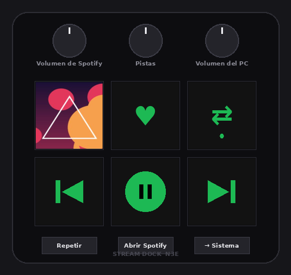
</p>

## Instalación

> 📘 **Guía completa paso a paso, con imágenes y solución de problemas: [docs/INSTALACION.md](docs/INSTALACION.md)**

**Requisitos:** Windows 10 u 11 (64 bits), un **Stream Dock N3E (`N3E_1B05`)** —
[ver compatibilidad](#dispositivo-compatible)— conectado por USB, e internet solo durante la instalación. No hace falta Python ni permisos de administrador.

1. **Descarga [`StreamDockLite-Setup.exe`](../../raw/main/descargas/StreamDockLite-Setup.exe)** ⭐ **opción recomendada**: un solo archivo
   que instala todo, sin Python ni permisos de administrador. También está en la carpeta
   [`descargas/`](descargas) y, cuando se publique, en [Releases](../../releases/latest).
2. **Ábrelo con doble clic.** Si Windows muestra «Windows protegió tu PC», pulsa
   **Más información → Ejecutar de todas formas** (sale porque el instalador no tiene firma de pago).
3. **Espera a que la ventana del instalador diga «Listo».** Tarda de 1 a 3 minutos.
4. **Cierra el software oficial Stream Dock del todo:** clic derecho en su icono junto al reloj → **Salir**.
   Solo un programa a la vez puede controlar el dispositivo.
5. **Abre Stream Dock Lite** desde el Escritorio o el menú Inicio. Arriba debe decir
   **● N3E conectado**.
6. **Si las imágenes no llenan las teclas:** **⚙ Ajustes → Pantallas de las teclas → Ver patrón**
   ([cómo calibrar](#calibrar-las-pantallas)).

<p align="center">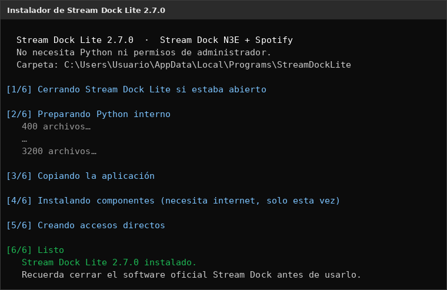</p>

- Se instala en `%LOCALAPPDATA%\Programs\StreamDockLite`, con accesos en el Escritorio y el menú Inicio
  (también **Diagnóstico del N3E**).
- Al cerrar la ventana, la app sigue funcionando junto al reloj: doble clic para abrirla,
  clic derecho para play/pausa, cambiar de canción o salir.
- **Actualizar:** lo más sencillo es abrir el nuevo `StreamDockLite-Setup.exe` (recomendado); también
  puedes usar *⚙ Ajustes → Actualizar desde archivo…* con el `.zip` de la nueva versión. Tu
  configuración se conserva en los dos casos.
- **Desinstalar:** *Configuración de Windows → Aplicaciones instaladas → Stream Dock Lite*.

## Spotify

Funciona con la **app de escritorio de Spotify**, sin iniciar sesión, a través de los controles
multimedia de Windows.

<p align="center">
  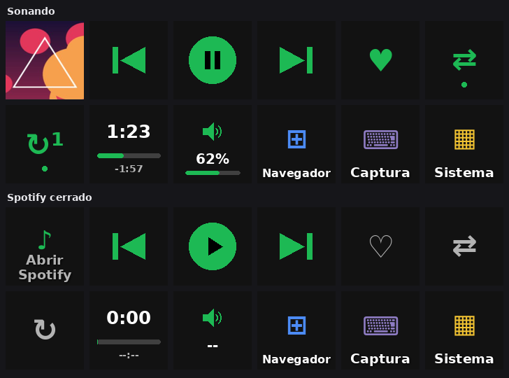
</p>

| Acción | Qué hace |
|---|---|
| Ahora suena | La portada de la canción, con el estilo que elijas. Pulsar = play/pausa |
| Play / Pausa | El icono cambia según el estado |
| Siguiente / Anterior | Cambia de canción |
| Aleatorio / Repetir | Se ilumina en verde cuando está activo |
| Progreso | Tiempo y barra de la canción |
| Volumen de Spotify | Sube, baja o silencia **solo Spotify**, no el resto del PC |
| Playlist / álbum | Pega un enlace de Spotify: la tecla muestra su portada y la reproduce |
| Me gusta | Guarda la canción (requiere conectar una cuenta, ver abajo) |

Las perillas vienen configuradas así: **1** = volumen de Spotify, **2** = cambiar de canción,
**3** = volumen del PC.

Spotify entrega a Windows la portada con una franja negra y su logo. La app la detecta y la recorta:

<p align="center">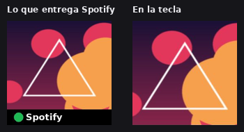</p>

**«Me gusta» y reproducir playlists al momento** usan la API web de Spotify: crea una app gratis en
`developer.spotify.com/dashboard`, añade la Redirect URI `http://127.0.0.1:8754/callback`, y pega el
*Client ID* en **Ajustes → Spotify → Conectar cuenta**. Según las reglas de Spotify de 2026, el dueño
de esa app debe tener Premium.

## Estilos de la tecla «Ahora suena»

En el inspector, **✨ Ver estilos…** abre una galería animada. Siete estilos, más opciones para la pausa
y el cambio de canción:

<p align="center">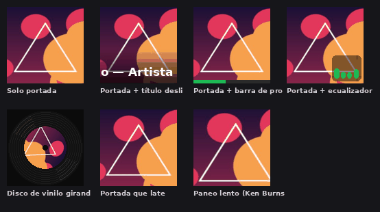</p>

- **Estilo:** solo portada · título deslizante · barra de progreso · ecualizador animado ·
  disco de vinilo girando · portada que late · paneo lento.
- **Al pausar:** no cambiar · atenuar · blanco y negro · icono de pausa · detener animación.
- **Al cambiar de canción:** ninguna · fundido · deslizar · acercar.
- **Recorte:** automático · manual (% de abajo) · no recortar.

<p align="center">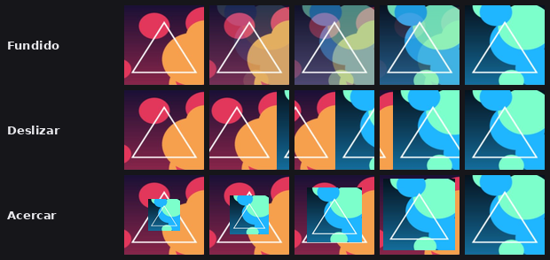</p>

## Reacción de teclas y botones

Sección **Reacción** del inspector, para todas las teclas menos «Ahora suena»:

<p align="center">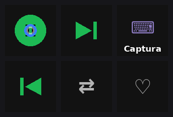</p>

- **Al pulsar:** onda, destello, hundir, borde de color o chispas.
- **Sonido:** clic, pop, tic, suave, teclado mecánico o burbuja, y tus propios `.wav`.
  Los botones sin pantalla también pueden sonar.
- **Con la música:** la tecla reacciona al **sonido real de Spotify** en cada momento.

<p align="center">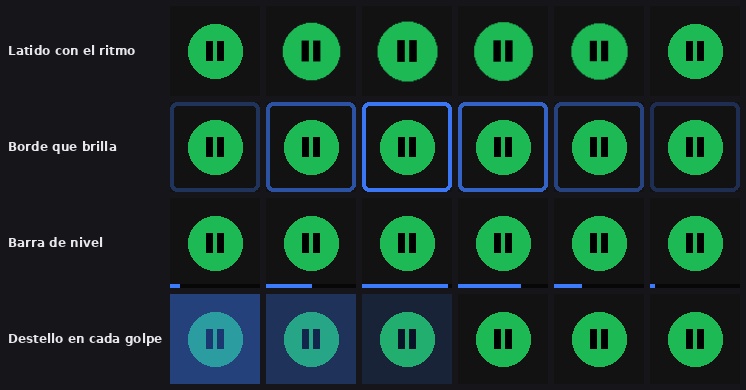</p>

## Apariencia: temas y fondos

Botón **🎨 Apariencia**:

- **Tema:** oscuro, claro o como Windows, con barra de título a juego.
- **Color de acento:** azul, verde Spotify, morado, rosa, naranja, rojo o cian.
- **Fondo:** ninguno · portada de la canción (cambia sola con fundido) · imagen · video o GIF.
- **Efectos:** desenfoque, velo, saturación, viñeta y movimiento lento, aplicados al momento.
  El fondo se pausa cuando la ventana está oculta.

<p align="center">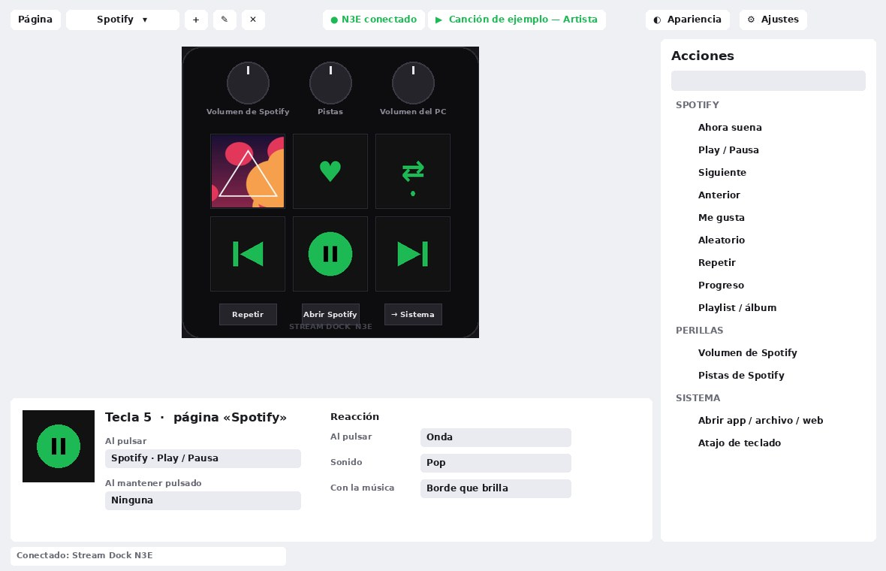</p>
<p align="center">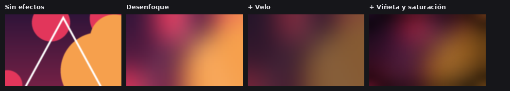</p>

## Protector de pantalla

**Ajustes → Protector de pantalla:** tras unos minutos sin tocar el N3E muestra la **portada gigante
repartida en las 6 teclas**, baja el brillo o apaga las pantallas. Cualquier toque lo despierta, sin
ejecutar ninguna acción.

<p align="center">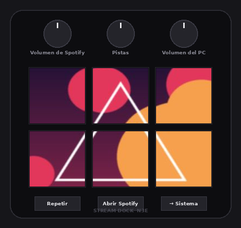</p>

## Calibrar las pantallas

Algunas unidades del N3E dibujan la imagen más pequeña o desplazada. En **Ajustes → Pantallas de las
teclas**, pulsa **Ver patrón** y, mirando el dispositivo:

- **− / +** ajusta el tamaño de 1 en 1 hasta que el marco blanco llegue a los bordes.
- **◀ ▲ ▼ ▶** mueve la imagen hasta centrarla. **●** vuelve al centro.
- **Giro** corrige la orientación si la flecha amarilla no apunta hacia arriba.
- **Borrar el fondo que dejó el software oficial** viene activado de fábrica.

<p align="center">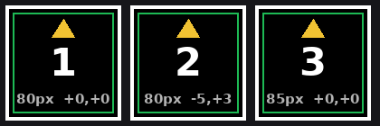</p>

## Actualizaciones

- **Ajustes → Actualizar desde archivo…** instala un `StreamDockLite-<versión>-actualizacion.zip`
  de [Releases](../../releases). Siempre pide confirmación.
- Antes de instalar se guarda una copia; **Ajustes → Volver a la versión anterior** la restaura.
- Botón **🔗 Claude** (opcional, desactivado de fábrica): permite recibir actualizaciones en una carpeta
  local que tú compartes; cada una se instala solo si pulsas «Sí».

## Historial de versiones

Resumen; el detalle de cada versión está en **[CHANGELOG.md](CHANGELOG.md)**.

| Versión | Novedades |
|---|---|
| **2.7.0** | Más rápida sin cambiar el aspecto · efectos al pulsar · sonidos · teclas que reaccionan a la música |
| ~~2.6.0~~ | Retirada (fondo con el video de Spotify: lenta y sin detección fiable) |
| 2.5.0 | Temas oscuro/claro/Windows · color de acento · fondos con imagen, video/GIF o portada |
| 2.4.3 | Centrado fino de las imágenes con flechas |
| 2.4.2 | Las ventanas se abren una sola vez |
| 2.4.1 | Borra el fondo del software oficial · tamaño y giro de imagen · patrón de prueba |
| 2.4.0 | Icono junto al reloj · teclas de playlists · protector de pantalla · instalador `.exe` sin Python |
| 2.3.0 | Estilos animados de «Ahora suena» · transiciones · recorte de la franja mejorado |
| 2.2.x | Instalador · actualizaciones con vuelta atrás · portada a tecla completa |
| 2.1.0 | Biblioteca de iconos con importación de `.zip`/`.rar` |
| 2.0.0 | Solo N3E_1B05 · interfaz estilo Elgato · integración con Spotify |
| 1.0.0 | Primera versión |

## Estado del proyecto y cómo mejorarlo

**Stream Dock Lite no está terminado.** Lo principal funciona, pero:

- Solo se ha usado con el N3E de una marca; otras unidades pueden necesitar calibrar las pantallas.
- Algunas funciones que dependen de Windows (sonidos, nivel de audio, fondos de video) no se han
  probado en todos los equipos.
- Las imágenes de este README son ilustraciones generadas con el código de la app, no capturas reales.
- Quedan muchas ideas por hacer: carpetas de teclas, doble toque, letras sincronizadas, perfiles
  automáticos por app, integración con OBS y Discord, otros modelos…

**Puedes hacer tus propios cambios o mejoras**, para ti o para compartirlos: descarga o haz *fork* del
código, modifícalo y, si quieres, propón tus cambios con un *Pull request*. La guía
**[CONTRIBUIR.md](CONTRIBUIR.md)** explica cómo empezar, dónde está cada cosa en el código, lo que
falta por probar y la lista de ideas pendientes. Si encuentras un fallo, abre un *Issue*.

## Para desarrolladores

```
StreamDockLite/      la app (Python 3.11+, tkinter, Pillow)
  app.py             interfaz principal
  dock.py            comunicación USB-HID con el N3E
  render.py          dibujo de las teclas
  spotify.py         Spotify (controles de Windows, volumen por app, API web opcional)
  reactions.py       efectos al pulsar y con la música
  sounds.py          sonidos generados al instalar
  background.py      fondos de la ventana
  theme.py           temas y colores
  updater.py         actualizaciones y copias de seguridad
installer/           instalador .exe en Go (incluye Python portátil con tkinter)
docs/img/            imágenes de este README
```

Ejecutar desde el código (Windows):

```
py -3.12 -m pip install -r StreamDockLite/requirements.txt
py -3.12 StreamDockLite/app.py
```

Compilar el instalador (Linux, macOS o WSL, con Go 1.22+):

```
./installer/build.sh      # → dist/StreamDockLite-Setup.exe y dist/StreamDockLite-<versión>-actualizacion.zip
```

## Créditos

- El protocolo USB de los dispositivos Mirabox/Ajazz se documentó gracias al trabajo de ingeniería
  inversa de los proyectos de código abierto [mirajazz](https://github.com/4ndv/mirajazz) y
  [opendeck-akp03](https://github.com/4ndv/opendeck-akp03).
- Python portátil del instalador: [python-build-standalone](https://github.com/astral-sh/python-build-standalone).
- Spotify, Elgato y Stream Dock son marcas de sus respectivos dueños.

Licencia [MIT](LICENSE).
