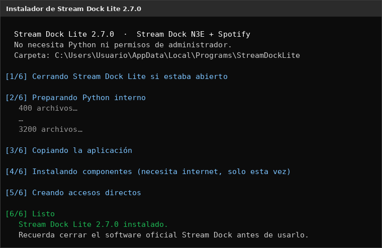
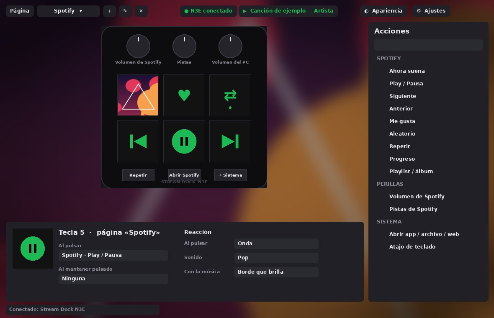
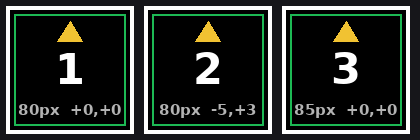

# Cómo instalar Stream Dock Lite

Guía paso a paso para Windows 10 y Windows 11. Tiempo aproximado: **5 minutos**.

## Contenido

1. [Antes de empezar](#1-antes-de-empezar)
2. [Descargar el instalador](#2-descargar-el-instalador)
3. [Ejecutar el instalador](#3-ejecutar-el-instalador)
4. [Cerrar el software oficial Stream Dock](#4-cerrar-el-software-oficial-stream-dock)
5. [Abrir Stream Dock Lite por primera vez](#5-abrir-stream-dock-lite-por-primera-vez)
6. [Ajustar las pantallas de las teclas](#6-ajustar-las-pantallas-de-las-teclas-si-hace-falta)
7. [Conectar Spotify](#7-conectar-spotify)
8. [Actualizar a una versión nueva](#8-actualizar-a-una-versión-nueva)
9. [Desinstalar](#9-desinstalar)
10. [Problemas frecuentes](#10-problemas-frecuentes)
11. [Instalar desde el código (avanzado)](#11-instalar-desde-el-código-avanzado)

---

## 1. Antes de empezar

| Necesitas | Detalle |
|---|---|
| **Windows 10 u 11** (64 bits) | |
| **Stream Dock N3E** (`N3E_1B05`) | Conectado por USB con un cable **de datos**, no solo de carga |
| **Internet** | Solo durante la instalación, para descargar los componentes de USB y Spotify (unos 60 MB) |
| **Spotify de escritorio** | Opcional, para las teclas de música. La versión de la Microsoft Store también sirve |

**No necesitas** instalar Python ni tener permisos de administrador: el instalador lo trae todo.

---

## 2. Descargar el instalador

### ⭐ Opción recomendada: `StreamDockLite-Setup.exe`

**[⬇️ Descargar StreamDockLite-Setup.exe](../../../raw/main/descargas/StreamDockLite-Setup.exe)** (unos 50 MB)

Es la forma más fácil y la que recomendamos: **un solo archivo que lo instala todo**. Trae su propio
Python, no pide permisos de administrador, crea los accesos directos, aparece en *Aplicaciones
instaladas* para desinstalarla, y también sirve para **actualizar** (conserva tu configuración).

También lo encuentras en la carpeta [`descargas/`](../descargas) del repositorio y, cuando se publique,
en **[Releases](../../../releases/latest)**.

### Otras opciones

| Opción | Cuándo usarla |
|---|---|
| `StreamDockLite-<versión>-actualizacion.zip` (en Releases) | Actualizar desde la propia app: *⚙ Ajustes → Actualizar desde archivo…* ([paso 8](#8-actualizar-a-una-versión-nueva)) |
| Desde el código | Si quieres usar tu propio Python o modificar la app ([paso 11](#11-instalar-desde-el-código-avanzado)) |

---

## 3. Ejecutar el instalador

1. Haz **doble clic** en `StreamDockLite-Setup.exe`.
2. Si Windows muestra **«Windows protegió tu PC»**:
   1. Pulsa **Más información**.
   2. Pulsa **Ejecutar de todas formas**.

   Este aviso aparece porque el instalador no está firmado con un certificado de pago.
   El código del instalador está en la carpeta [`installer/`](../installer) por si quieres revisarlo.
3. Se abre una ventana negra que va mostrando los pasos. **No la cierres** hasta que diga **«Listo»**:

<p align="center"></p>

| Paso | Qué hace |
|---|---|
| 1/6 | Cierra Stream Dock Lite si ya estaba abierto (al reinstalar o actualizar) |
| 2/6 | Prepara el Python interno de la app (solo la primera vez) |
| 3/6 | Copia la aplicación |
| 4/6 | Descarga los componentes de USB, Spotify y volumen (**necesita internet**, puede tardar 1–3 minutos) |
| 5/6 | Crea los accesos directos y registra la app en *Aplicaciones instaladas* |
| 6/6 | Listo: se abre Stream Dock Lite |

La app se instala en `%LOCALAPPDATA%\Programs\StreamDockLite` y crea:
- Un acceso **Stream Dock Lite** en el **Escritorio**.
- Una carpeta **Stream Dock Lite** en el **menú Inicio**, con la app y la herramienta **Diagnóstico del N3E**.

---

## 4. Cerrar el software oficial Stream Dock

Solo un programa a la vez puede controlar el dispositivo, así que hay que cerrar el oficial **del todo**:

1. Mira los iconos junto al reloj de Windows (abajo a la derecha; pulsa **^** si están ocultos).
2. Si aparece el icono del software **Stream Dock**, haz clic derecho sobre él y elige **Salir**.
3. Para que no vuelva a abrirse solo al encender el PC: **Administrador de tareas** (`Ctrl + Shift + Esc`)
   → pestaña **Aplicaciones de arranque** → selecciona **Stream Dock** → **Deshabilitar**.

---

## 5. Abrir Stream Dock Lite por primera vez

1. Abre **Stream Dock Lite** desde el Escritorio o el menú Inicio. El instalador ya la abre al terminar.
2. Arriba debe aparecer **● N3E conectado** en verde. Las 6 teclas del dispositivo muestran la página de Spotify.
3. Prueba a pulsar una tecla: se ilumina en la vista previa y hace su acción.

<p align="center"></p>

Uso básico:
- **Arrastra** una acción de la lista de la derecha a una tecla, botón o perilla.
- Haz clic en una tecla para cambiar su título, colores, icono, reacción y acciones en el inspector de abajo.
- Al **cerrar la ventana**, la app sigue funcionando junto al reloj. Para salir del todo: clic derecho
  en su icono → **Salir**.
- Para que se abra al encender el PC: **⚙ Ajustes → General → Iniciar con Windows**.

---

## 6. Ajustar las pantallas de las teclas (si hace falta)

Si las imágenes se ven más pequeñas, desplazadas, giradas o con un fondo de otro color alrededor:

1. Abre **⚙ Ajustes → Pantallas de las teclas** y pulsa **Ver patrón**.
2. Mira el N3E: cada tecla muestra un marco blanco, una flecha amarilla y su número.
3. Pulsa **− / +** hasta que el marco blanco toque los 4 bordes de la tecla.
4. Usa **◀ ▲ ▼ ▶** hasta que el marco quede centrado. **●** vuelve al centro si te pierdes.
5. Si la flecha amarilla no apunta hacia arriba, cambia el **Giro**.
6. Toca cualquier tecla del N3E para salir del patrón y pulsa **Guardar**.

<p align="center"></p>

---

## 7. Conectar Spotify

**Lo básico funciona solo, sin cuenta:** abre Spotify de escritorio y pon una canción. La tecla
«Ahora suena» muestra la portada, y funcionan play/pausa, siguiente, anterior, aleatorio, repetir,
progreso y el volumen de Spotify en la perilla 1.

**Opcional: «Me gusta» y reproducir playlists al pulsar una tecla.** Esto necesita la API de Spotify:

1. Entra en **developer.spotify.com/dashboard** con tu cuenta de Spotify y pulsa **Create app**.
2. Ponle cualquier nombre y descripción.
3. En **Redirect URIs** añade exactamente: `http://127.0.0.1:8754/callback`
4. Marca **Web API** y guarda.
5. Copia el **Client ID** de la app que creaste.
6. En Stream Dock Lite: **⚙ Ajustes → Spotify**, pega el Client ID y pulsa **Conectar cuenta**.
7. Se abre el navegador: acepta los permisos. Cuando diga «¡Listo!», vuelve a la app.

> Según las reglas de Spotify de 2026, la cuenta dueña de esa app de desarrollador debe tener **Premium**.

---

## 8. Actualizar a una versión nueva

**Opción A (recomendada): el nuevo instalador.** Descarga el último
[`StreamDockLite-Setup.exe`](../../../raw/main/descargas/StreamDockLite-Setup.exe) y ábrelo. Reemplaza la versión anterior; no hace falta
desinstalar nada.

**Opción B: desde la app.**
1. Descarga `StreamDockLite-<versión>-actualizacion.zip` desde [Releases](../../../releases).
2. En la app: **⚙ Ajustes → Actualizaciones → Actualizar desde archivo…** y elige el `.zip`.
3. Revisa la versión y las novedades, y pulsa **Sí**. La app se reinicia sola.

En los dos casos **se conserva** tu configuración: páginas, teclas, iconos, sonidos y apariencia.
Antes de actualizar se guarda una copia; si algo no te gusta: **⚙ Ajustes → Volver a la versión anterior**.

---

## 9. Desinstalar

1. **Configuración de Windows → Aplicaciones → Aplicaciones instaladas**.
2. Busca **Stream Dock Lite** → **⋯** → **Desinstalar**.
3. Te pregunta si quieres borrar también tu configuración, iconos y copias de seguridad.
   Elige **No** si piensas volver a instalarla.

---

## 10. Problemas frecuentes

| Problema | Solución |
|---|---|
| Arriba dice **● N3E desconectado** | Cierra el software oficial del todo ([paso 4](#4-cerrar-el-software-oficial-stream-dock)). Prueba otro cable USB (de datos) u otro puerto. Luego **⚙ Ajustes → Reconectar** |
| Sigue sin detectarlo | Abre **Diagnóstico del N3E** desde el menú Inicio: dibuja los números 1–6 en las teclas y guarda un `informe_deteccion.txt` con lo que encontró |
| Las imágenes salen pequeñas, movidas o con fondo alrededor | Calibra las pantallas ([paso 6](#6-ajustar-las-pantallas-de-las-teclas-si-hace-falta)) |
| Las imágenes salen en blanco o giradas aunque calibres | **⚙ Ajustes → Stream Dock N3E → Protocolo**: prueba **3** y luego **2** |
| El instalador falla en el paso 4/6 | Revisa tu conexión a internet y vuelve a abrir el instalador; continúa donde lo dejó |
| Las teclas de Spotify no reaccionan | Usa **Spotify de escritorio** (no el reproductor web) y pon una canción |
| La perilla no cambia el volumen de Spotify | Reinstala la app con el `.exe` para que descargue de nuevo los componentes |
| «Windows protegió tu PC» | Normal en programas sin firma de pago: **Más información → Ejecutar de todas formas** |
| La app no aparece en la barra de tareas | Está junto al reloj: doble clic en su icono para abrirla |

Si nada funciona, abre **Ver registro** (abajo a la derecha de la app) y revisa el último mensaje.

---

## 11. Instalar desde el código (avanzado)

Para ejecutar la app sin instalador, con tu propio Python:

```
:: Windows, con Python 3.11 o más reciente
git clone <url de este repositorio>
cd Stream-Dock-Lite
py -3.12 -m pip install -r StreamDockLite/requirements.txt
py -3.12 StreamDockLite/app.py
```

Para compilar el instalador `.exe` (Linux, macOS o WSL, con Go 1.22+, `zip` y `curl`):

```
./installer/build.sh
# → dist/StreamDockLite-Setup.exe
# → dist/StreamDockLite-<versión>-actualizacion.zip
```
